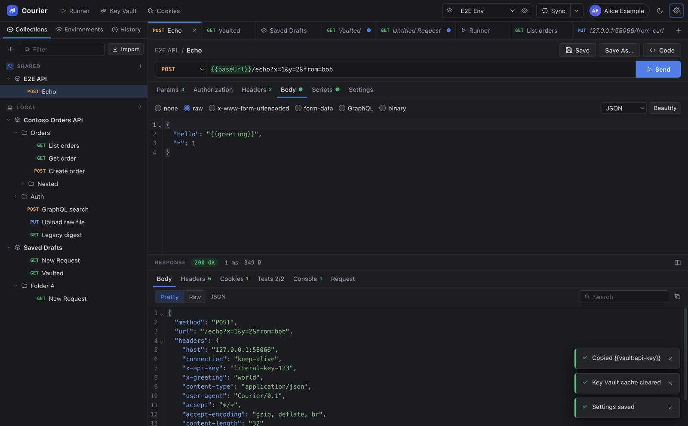
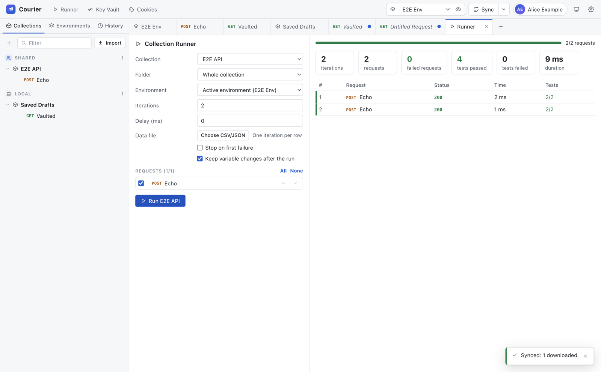
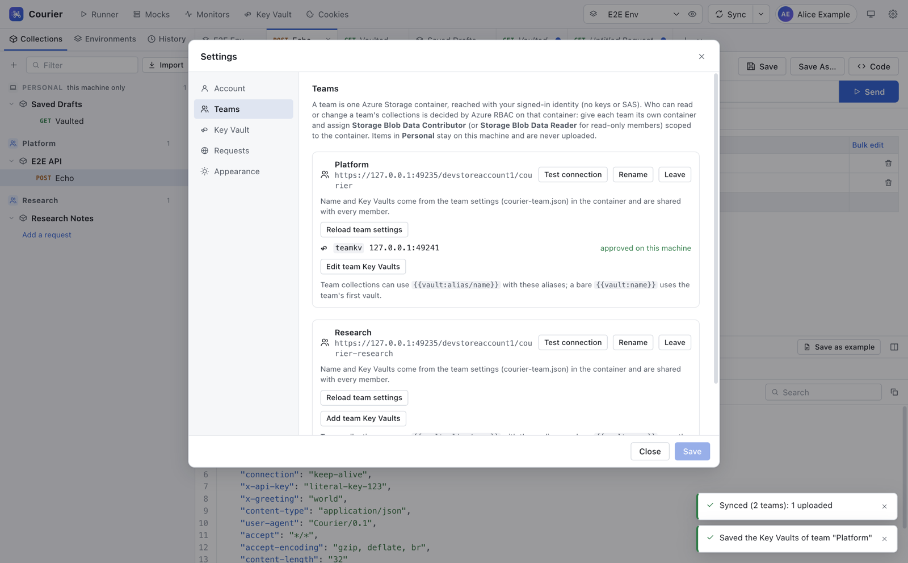
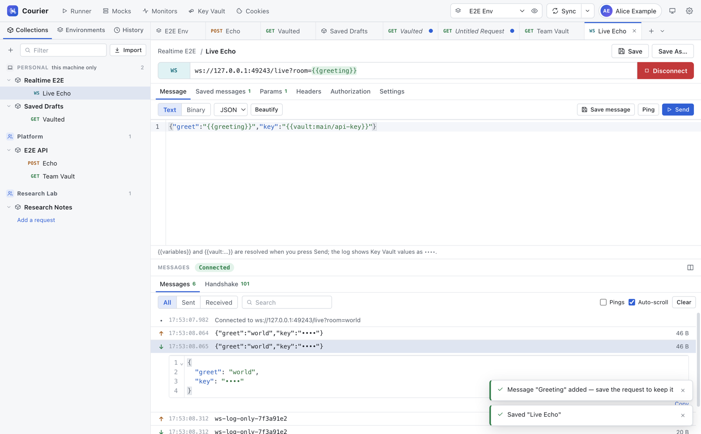
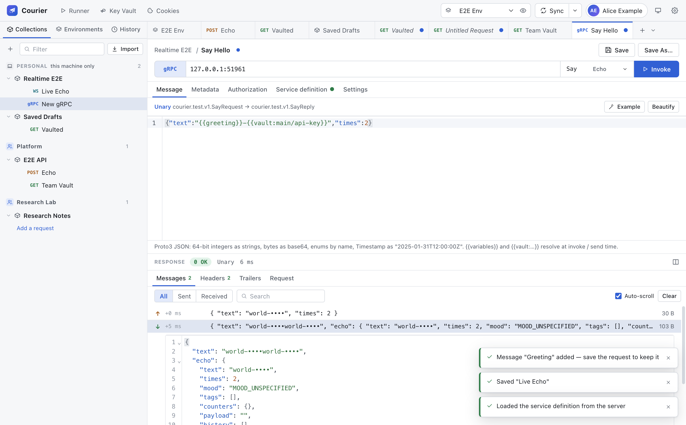
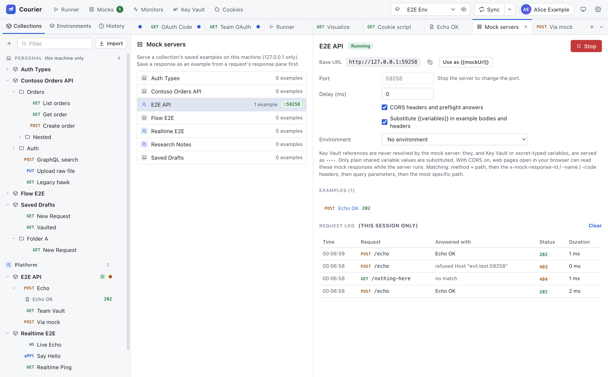
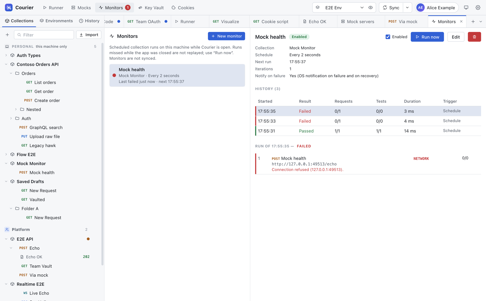

<p align="center"></p>

# Courier

[](https://github.com/cguldogan/Courier/actions/workflows/ci.yml)

Courier is a desktop API client (a Postman alternative) built with Electron and React. Your team shares
collections and environments through **your own Azure Storage account**, secrets come from **Azure Key
Vault**, and you sign in with your **Azure (Entra ID) identity**. There are no Courier servers,
storage account keys, SAS tokens or connection strings.

<p align="center"></p>

- Requests with params, headers, every common body type, and pre-request and post-response
  scripts (`pm.*` subset, sandboxed in QuickJS), including `pm.execution.setNextRequest`,
  `pm.cookies` / `pm.cookies.jar()` and `pm.visualizer`
- Auth: Basic, Bearer, API key, JWT bearer, Digest, OAuth 2.0 (client credentials, and authorization
  code with PKCE in the system browser), AWS Signature v4, NTLM, and an Azure identity token; set per
  request, folder or collection and inherited
- Collections, folders, environments, globals and history. Tabs keep unsaved drafts.
- Collection runner with iterations, delay, stop-on-failure and a CSV/JSON data file
- Import Postman v2.0/v2.1 collections and environments, OpenAPI 3 and cURL; export to Postman or Courier JSON
- Code snippets for cURL, JavaScript `fetch` and Python `requests`. Secrets in snippets are masked.
- **WebSocket** requests (connect, text and binary messages, saved messages, a message log) and **gRPC**
  requests (server reflection or `.proto` files, all four call types, metadata, TLS), saved in
  collections and synced like HTTP requests (see [WebSocket and gRPC](#websocket-and-grpc))
- Cookie jar, plus light and dark themes that follow the system setting
- **Saved response examples** on requests, a **local mock server** per collection that serves them on
  127.0.0.1, and **monitors** that run a collection on a schedule while the app is open (see
  [Examples, mock servers and monitors](#examples-mock-servers-and-monitors))
- A command-line runner, `courier run`, for build pipelines: the same engine, console / JSON / JUnit
  reports, managed identity or Azure CLI sign-in (see [Command-line runner](#command-line-runner)), and
  `courier mock` to serve a collection's examples headless

## Screenshots

Captured by the end-to-end test run; the accounts and endpoints shown are test fixtures.

| | |
| --- | --- |
|  Request, scripts and response |  Dark theme |
|  Sync conflict |  Key Vault browser |
|  Collection runner |  Teams |
|  WebSocket |  gRPC |
|  Mock servers |  Monitors |

For the feature-by-feature comparison with Postman, see the parity table in
[docs/RESEARCH.md](docs/RESEARCH.md#4-parity-table).

## Personal and teams

Every collection and environment belongs to **Personal** or to exactly one **team**. Move it with
right-click, then **Move to…**:

| Where | Stored | Who can read it |
| --- | --- | --- |
| **Personal** | This machine only (userData). Never uploaded; works offline with no sign-in. | You |
| **A team** | That team's Azure Storage container | Whoever Azure RBAC lets read that container |

A team is one storage location: an account URL plus a container. You can belong to any number of
teams. Isolation between teams is whatever Azure RBAC grants, so give **each team its own container**
and assign **Storage Blob Data Contributor** (or **Storage Blob Data Reader** for read-only members)
**scoped to that container**. Courier keeps each team's local cache separately, so one team's items
never show up under another team, on any machine.

Teams are managed in **Settings → Teams**:

- **Join or create a team**: enter the account URL and container, then **Look up**. If the container
  has team settings (`courier-team.json`), Courier shows the team's name and Key Vaults and you
  **Join**. If it has none, someone with write access **Creates** the team (the file is written with
  `If-None-Match: *`, so two people cannot create it twice). Read-only members can **Join read-only**
  under a name of their choice; a member with write access can later use **Create team settings** on
  the team's card.
- **Rename** and **Edit team Key Vaults** change `courier-team.json` for everyone (without team
  settings, Rename only changes the name on this machine). The write is ETag-protected: if a teammate
  changed it meanwhile, nothing is overwritten and the latest version is loaded. **Reload team
  settings** reads it again; every sync does too.
- **Leave** removes the team and its items from this machine (it asks first if there are unsynced
  changes). It never deletes anything from the container.
- **Test connection** checks the container and your role.

Team items are cached locally, so Courier works offline. Saving only marks an item as changed. To
upload your changes and download your teams' changes, press **Sync**: it syncs every team and reports
per team. One team failing (no access, missing container, network) never stops the others; the
sidebar shows an error badge on that team, and on a 403 it names the role to ask for. Uploads use
ETag preconditions. When the team's copy and your copy both changed, Courier shows a conflict dialog
that compares your version with the team's version. You can then **Keep mine**, **Take theirs** or
**Keep both** (your version is saved as a copy).

Moving an item from one team to another (or to Personal) moves it here right away. On the next sync
it is uploaded to the new team, and only after that upload has succeeded is the old blob deleted,
with `If-Match` on the version you last saw. If a teammate changed it in the old team meanwhile, the
old copy is kept.

Before an item goes to a team, Courier scans it for literal credentials, such as an `Authorization`
or `X-Api-Key` header, a Basic/Bearer/API-key/OAuth/Digest/NTLM password or secret, an AWS secret key
or session token, a JWT secret or private key, or a secret-looking variable. It then
asks you to cancel or proceed. The better fix is a Key Vault reference (see below).

### Blob layout

Each team container holds the team settings and one JSON blob per collection (the whole tree) or
environment. The JSON is deterministic and pretty-printed:

```
<team container>/
  courier-team.json                   { "version": 1, "name": "...", "vaults": [{ "alias", "url" }] }
  shared/collections/<id>.json
  shared/environments/<id>.json
```

Each document records `updatedBy` (UPN or name) and `updatedAt`. Some data never leaves this machine:
Personal items, current values, globals, history, cookies and settings. Variables of type **secret**
are written to team documents with an empty value. Their real value lives only in this machine's
current values.

### Upgrading from the single storage account

Earlier versions had one storage account in settings, with a shared area and a per-user area in
the same container. On the first start Courier migrates once: the storage setting becomes a team
(named "Team" until the first sync reads a `courier-team.json`; if the container has none, use
**Create team settings** to name it for everyone), shared items become that team's
items with their sync state, and items from the old per-user area become Personal items. Their old
blobs in the container are left untouched; delete them yourself if you no longer need them.

## Secrets: Azure Key Vault references

Configure your own vaults under **Settings → Key Vault** as `alias` + `https://<name>.vault.azure.net`.
A team can also list vaults in its team settings (**Settings → Teams → Edit team Key Vaults**), so
teammates don't each have to set up the same aliases. You can use a reference anywhere `{{variables}}`
work: URL, params, headers, body and auth fields.

```
{{vault:secret-name}}            default vault (see below)
{{vault:alias/secret-name}}      a specific vault
{{vault:alias/secret-name@ver}}  a pinned version
```

Which vaults a reference can reach depends on the collection it is sent from:

| Collection | Aliases are looked up in | `{{vault:name}}` uses |
| --- | --- | --- |
| A team's collection | the team's vaults first, then your own vaults | the team's first vault (your first vault if the team lists none) |
| Personal collection, or a request outside a collection | your own vaults only | your first vault |

Environments follow the collection the request belongs to. A team's vault list comes from teammates,
so Courier treats it as untrusted: a vault URL must be `https://<name>.vault.azure.net` (or another
Azure Key Vault host; no credentials, path or query), entries that are not are ignored and shown in
the team settings, and **a team vault is only used after you approved its host on this machine**.
Until then, a request that needs it is not sent and fails with `VAULT_NOT_APPROVED`, and the response
pane offers **Review team Key Vault…**, which shows the host. Approvals are stored in userData per
team and vault URL, so when a teammate points an alias at a different host you are asked again.
Vaults you type in yourself (your own, or team vaults you add) count as approved; re-saving the list
never approves an entry a teammate added.

A variable can also have the type **Key Vault**, with a reference such as `main/api-key` as its
value. A plain `{{apiKey}}` then resolves through Key Vault. Scripts can call
`pm.vault.get('name')`, but only in collections you allow (see below).

### Scripts and Key Vault: allowed per collection, on this machine

Team collections sync through the team's container, so anyone with write access to it can change a
collection's scripts, and scripts run with the identity of whoever presses Send. By default, scripts
therefore cannot obtain Key Vault values. To let a collection's scripts read secrets, open the collection's
settings (**Overview**) and turn on **Allow this collection's scripts to read Key Vault secrets**.

- The permission is stored in this machine's userData, keyed by collection id. It is never part of the
  collection document, so it is never uploaded and a teammate cannot turn it on for you. It starts
  off for every collection, in Personal and in every team, including imported files. It applies to
  your own vaults and to team vaults alike (team vaults also need their host approved).
- The permission is bound to a hash of all script text in the collection (collection, folder and
  request scripts). Your own saves keep it. If the scripts change any other way, for example through
  a sync or by taking "theirs" in a conflict, the permission turns off, and the setting says when and who
  last updated the collection.
- Only saved script text gets the permission. A request tab with unsaved script edits, a request
  reopened from history, or a "duplicate as draft" copy must be saved first. Saving counts as approval, so
  review the script in the tab before you save it into an allowed collection.
- When a script is blocked, `pm.vault.get` rejects, and `pm.sendRequest` rejects if its URL, headers
  or body contain a `{{vault:…}}` reference. The error code is `VAULT_SCRIPT_BLOCKED`, and the response
  pane and the runner offer **Open collection settings**. A blocked pre-request script stops the
  request from being sent. Some other things also change while scripts are blocked:
  - Variables whose value holds a `{{vault:…}}` reference, such as Key Vault-typed variables, read as
    `••••` in scripts (`pm.variables`, `pm.environment`, `replaceIn`, `toObject`). A blocked script that
    copies such a value into the request, for example `'Bearer ' + pm.environment.get('apiKey')`, sends a
    literal `••••` and gets no error. When scripts are allowed, they see the reference text and resolve it
    with `pm.vault.get`.
  - Test scripts see the response with Key Vault values masked.
  - A pre-request script cannot add `{{vault:…}}` references to the request, or change where a request
    that carries them is sent (its origin or OAuth token URL). In the runner, this also covers variables
    that an earlier request of the same run changed.
- `{{vault:…}}` references in the request itself (URL, params, headers, body and auth) always resolve.
  They are visible in the editor. However, a declarative reference in a team request is sent to whatever URL
  that request targets, so review team requests (and the variables their URL uses) before you send
  them.

Known limits: the hash covers script text only. An allowed script that takes its destination or the
secret name from a variable can still be steered by someone who edits that variable. A variable
value that a script persisted in one send is the baseline for later sends.

Courier fetches secrets in the main process at send time, using your identity. It keeps them in
memory for a short time (the TTL is configurable) and never writes them to disk. Wherever a secret
could show up outside the live request, Courier shows `••••` instead: history, the console, the
response view, the "Request" view and code snippets.

The **Key Vault** browser on the toolbar lists the secret names in each vault. It can reveal a value
on demand (the value hides again after 20 s), copy a `{{vault:…}}` reference, create a new version,
and clear the cache.

## Authorization

Every auth field accepts `{{variables}}` and `{{vault:…}}` references. Auth is set on a request, a
folder or the collection; **Inherit** uses the nearest parent's.

| Type | Notes |
| --- | --- |
| Basic, Bearer, API key | Header (or query parameter for API key) |
| JWT bearer | HS256/384/512, RS256/384/512, ES256/384. Payload JSON with variables, extra header fields, header prefix, or a query parameter. The secret or PEM private key may be a Key Vault reference. Signed at send time. |
| Digest | RFC 7616: MD5 and SHA-256 (and their `-sess` forms), `qop=auth` (and `auth-int`), nonce count, `opaque`, `userhash`. Courier answers the server's 401 challenge, reuses the nonce for later requests with an increasing nonce count, and retries once when the server says the nonce is stale. |
| OAuth 2.0 client credentials | Token fetched before the request and cached in memory |
| OAuth 2.0 authorization code | With PKCE (S256, default) or plain with a client secret. See below. |
| AWS Signature | SigV4 in the `Authorization` header, or a presigned URL (query signing). Optional session token. For S3, `x-amz-content-sha256` is sent and signed (an `x-amz-content-sha256` header you set yourself, for example `UNSIGNED-PAYLOAD`, is respected). The request is signed last, exactly as it goes out; the cookie jar's `Cookie` header is not signed. |
| NTLM | NTLMv2 only (no LM / NTLMv1). The three messages run on one dedicated connection, never the shared pool. `DOMAIN\user` in the username field works too. |
| Azure identity | Token for the signed-in identity (see Sign-in modes) |

Values that could be replayed or cracked offline are masked (`••••`) in history, the console, the
Request view and snippets: acquired OAuth tokens, signed JWTs, the Digest and NTLM `Authorization`
values, the AWS session token and a presigned URL's signature. Code snippets show placeholders for
every signed or negotiated scheme (for example `Digest <computed from the server challenge at send time>`).

### OAuth 2.0 authorization code

**Get new token** in the Authorization tab opens the **system browser** at the authorization URL
(http/https only). The identity provider redirects to a listener on `127.0.0.1` with a random port, or
the fixed port of the redirect URI you set (many identity providers need a registered one; only
loopback `http://127.0.0.1:…`, `localhost` or `[::1]` redirect URIs are accepted). Courier checks
`state` and, with PKCE, sends the S256 `code_verifier`; it gives up after 5 minutes, and **Cancel**
stops waiting. The token and refresh token are cached and refreshed automatically a minute before
expiry. **Send** never opens a browser: without a token it fails with `AUTH_REQUIRED`. The panel shows
the expiry and a masked preview (`e2e…3fa`) only; **Clear token** forgets it.

Token storage: tokens live in main-process memory and are persisted to `oauth-tokens.bin` in userData
**only encrypted with the OS keystore** through Electron `safeStorage` (Keychain on macOS, DPAPI on
Windows, libsecret/kwallet on Linux). When that is unavailable (including Linux's `basic_text`
fallback, which uses a fixed key), tokens stay in memory and are gone after a restart. Tokens are never
part of a collection document, so they are never synced.

A token belongs to the resolved authorization URL, token URL, client id, scope, audience, extra
parameters and redirect URI, and to the collection's context (Personal or its team). A variable that
points the token URL somewhere else therefore needs a new token; an existing refresh token is never
sent to a new host. For a **team** collection those URLs come from teammates, so before the first
token for a given authorization host + token host, Courier shows both hosts (where the browser goes,
and which host receives the code and the client secret) and asks you to approve them. Approvals are
stored on this machine per team and host pair.

## WebSocket and gRPC

**New** (the chevron next to **+** in the tab bar, or a collection's context menu) offers HTTP,
WebSocket and gRPC requests. The sidebar shows **WS** or **gRPC** where HTTP shows the method. Tabs,
unsaved changes, rename, duplicate, move, drag and drop and delete work as for HTTP requests, and
⌘/Ctrl+Enter connects or sends (WebSocket) and invokes or sends (gRPC). All network traffic runs in the
main process.

Both kinds take `{{variables}}` and `{{vault:…}}` references in the URL or address, headers or metadata,
params and every message. They resolve when you connect, send or invoke, with the same precedence and the
same Key Vault rules as an HTTP send. Team vault hosts still need approval on each machine. Auth is
inherited like HTTP auth. Basic, Bearer, API key, OAuth 2.0 (client credentials or an authorization-code
token you already got), Azure identity and JWT bearer work. Digest, NTLM and AWS Signature need a request
or response that these protocols don't have, so connecting fails with a clear error. Key Vault values and
tokens appear as `••••` in everything the window shows, including echoed messages and handshake headers.
Message logs live in memory only: they are bounded (2,000 messages or 8 MB, with a notice when older
messages drop out) and are never written to disk.

**WebSocket**: `ws://` / `wss://` URL with query params, headers, subprotocols, and settings for TLS
verification, handshake timeout, maximum message size (a larger incoming message closes the connection with
1009) and auto-reconnect (off by default). The handshake sends the cookie jar's cookies and stores
`Set-Cookie`. Messages are text (JSON, XML or plain) or binary typed as base64 or hex. Saved messages are a
named list on the request: load one, or send it with one click. The log shows direction, time, size and a
text or hex preview. Expand a message for pretty JSON. You can filter by direction, search, show
ping/pong frames, toggle auto-scroll and clear the log. The Handshake tab shows the request headers and the
101 response.

**gRPC**: `host:port`, `grpc://` (plaintext) or `grpcs://` (TLS). You can turn TLS on or off, turn
verification off, and choose a CA certificate, client certificate and key. Those file paths are
remembered on this machine only (`grpc-tls.json` in userData), never synced, and only files picked in
the dialog are read. Set metadata rows, a deadline and the maximum receive size. The service definition comes from **server
reflection** (`grpc.reflection.v1`, falling back to `v1alpha`) or from **.proto files** with import
directories (`google/protobuf/*.proto` are built in). It is stored with the request (file names only, no
paths), so teammates can call the service without the files; load it again to refresh. Pick the method
from a searchable list. **Example** builds a JSON skeleton of the request message. Messages use the
proto3 JSON mapping: 64-bit integers as strings, bytes as base64, enums by name, `Timestamp` as RFC 3339
text, `Duration` as `"1.5s"`, wrappers as plain values, and `Struct` as plain JSON. Unknown fields or
wrong types are refused before anything is sent, with the field named
(`Field "address.cty": courier.test.v1.Address has no field "cty"`). All four call types work. For
client and bidirectional streams, Invoke opens the stream; **Send** sends the editor's message, **End
stream** half-closes, and **Cancel** cancels the call. The response shows the status code and name, the
status message with a hint for `UNAVAILABLE`, `UNAUTHENTICATED`, `DEADLINE_EXCEEDED` and
`UNIMPLEMENTED`, headers, trailers, each message with its time since the call started, and the total
duration.

What HTTP-only features do with them: the collection runner and `courier run` skip them and say
which ones (the JSON report lists them under `run.skipped`). The Postman export leaves them out, since
Postman v2.1 has no such request, and the export lists them. Code snippets and history do not cover
them. The secret scan before a team upload checks WebSocket headers, gRPC metadata and their auth.

## Examples, mock servers and monitors

Postman runs mock servers and monitors in its cloud. Courier runs them on your machine.

### Saved response examples

After a Send, **Save as example** in the response pane stores the response on the request (the request
must be saved in a collection). An example holds:

- the request as sent, in its *template* form: method, URL, query, headers and body with `{{variables}}`
  and `{{vault:…}}` unresolved, so no resolved secret is stored. Auth, scripts and local file paths are
  not stored.
- the response as the window shows it: status, status text, headers and body. Key Vault values and tokens
  are already `••••` there, and the values of `secret`-typed collection and environment variables are
  masked the same way before the example is stored. Text bodies are cut at 1,000,000 characters, and the example says so. Binary
  bodies (images, PDF…) are kept as base64 up to about 1.1 MB, larger ones not at all.

Response headers that usually carry credentials or session state (`Set-Cookie`, `Authorization`,
`Proxy-Authorization`, `Cookie`, API-key and token headers…) are left out unless you tick them in the
save dialog, one by one. Example request headers and the credential headers you kept are part of the
secret scan before a team upload.

Examples appear under their request in the sidebar (the chevron next to the method). They open in a tab
that shows the request read-only and lets you edit the name, status, status text, headers, body and body
language. Rename, duplicate and delete are in the context menu. Examples live in the collection file, so
they sync with team collections and move, duplicate and export with them. A collection without examples
is written byte for byte as before. Request tabs never hold examples: saving a request keeps its
examples, and they change only through the example tab or the sidebar.

Postman v2.1: an item's `response[]` imports as examples (`originalRequest`, `code`, `status`, `header`,
`body`, `_postman_previewlanguage`), and the export writes them back. A Postman body is text, so a binary
example is exported with an empty `body` and its data in a `_courier_bodyBase64` field that Courier reads
back and Postman ignores.

### Mock servers

**Mocks** in the top bar, or **Mock server…** in a collection's menu, opens the mock servers tab. It
lists every collection with its number of examples. For each one you can start or stop a server, choose
the port (empty or 0 means any free port), copy the base URL, and see a live request log. **Use as
{{mockUrl}}** sets a `mockUrl` collection variable to the base URL. Several collections can be mocked at
once on different ports. A running server shows a small server icon on its collection in the sidebar.

- **Local only.** A server listens on `127.0.0.1` and nowhere else; there is no setting for another
  interface. It answers only requests whose `Host` is `127.0.0.1:<port>` or `localhost:<port>` (403
  otherwise), which stops DNS-rebinding pages. It replays saved examples and does nothing else: it never
  proxies, reads files or runs scripts. Request bodies are read up to 1 MB and discarded (413 above
  that). Malformed requests get a 400.
- **Matching.** Matching starts with the method and path. The example's path is its URL without the
  base: a leading `scheme://host`, a leading `{{variable}}` such as `{{baseUrl}}`, or a bare host before
  the first `/`. A path segment written as `:id` or `{{id}}` matches any segment, and `v{{n}}` matches
  `v` followed by anything. Trailing and doubled slashes don't matter, and a HEAD request falls back to
  the GET examples. Among those matches, the `x-mock-response-id`, `x-mock-response-name` (case-insensitive)
  and `x-mock-response-code` request headers narrow the choice, in that order. Unlike Postman's cloud
  mocks, these headers never pick an example on another path. Next, the example whose query parameters
  agree with the most of the request's wins (a `{{variable}}` value accepts any value). Then the most
  specific path wins (`/users/me` before `/users/:id`), then the first in collection order.
- **No match** gives a 404 JSON body (`mockRequestNotFoundError`) listing the method and path, what was
  tried, and the five closest examples with the reason each did not match.
- **Settings** (per collection, remembered on this machine):
  - a fixed delay;
  - CORS, on by default: `Access-Control-Allow-*` headers on every answer, and preflight `OPTIONS`
    answered with 204. While CORS is on, web pages open in your browser can read mock responses.
    `Access-Control-Allow-Private-Network` is never sent;
  - `{{variable}}` substitution in example bodies and headers, on by default, from the collection's and
    a chosen environment's **shared** values of plain variables. This machine's current values are not
    used. **Key Vault references are never resolved by the mock server**: they, and `vault`- and
    `secret`-typed variables, are served as `••••` (`****` in headers).
- Edits to examples apply to the next request without a restart. Framing headers saved with the response
  (`Content-Length`, `Content-Encoding`, `Transfer-Encoding`…) are not replayed. Each answer carries
  `x-mock-example-id`.
- The request log (time, method, path, the example or "no match", status, duration) keeps the last 500
  requests in memory only. Servers stop when you stop them, when their collection is deleted (also by a
  sync or by leaving its team) and when the app quits. They are not restarted when the app starts.
  A port that is in use is reported as such.

### Monitors

A monitor is a saved, scheduled run of a collection on this machine: **Monitors** in the top bar, or
**New monitor…** in a collection's menu. It has a name, a collection (Personal or team), an optional
folder, an environment, iterations and a schedule. The schedule is every N minutes or hours, every day
at a time, or on weekdays at a time, in local time. A 09:00 monitor stays at 09:00 across
daylight-saving changes. A time skipped by the spring change runs at the shifted time (02:30 → 03:30),
and a time repeated by the autumn change runs once. Each monitor also has an enabled flag and a
"notify on failure" flag. Monitors and their run history are stored in userData (`monitors.json`,
`monitor-runs/`) and are never synced.

- Runs happen only **while the app is open**. The scheduler checks every 15 seconds. **Runs missed
  while the app was closed are not replayed**: the next run is computed from when the app starts, and
  **Run now** runs one at once. After sleep or any other long gap, a monitor runs at most once to catch
  up. A monitor never overlaps itself: an occurrence that falls due while the previous run is still
  going is skipped.
- A run uses the collection runner's engine with the same rules as an interactive run. Scripts read Key
  Vault only if the collection is allowed on this machine, and team vault hosts must be approved. A
  monitor gets no extra privileges: a run that needs a missing approval fails with the usual error
  (`VAULT_SCRIPT_BLOCKED`, `VAULT_NOT_APPROVED`), which says how to grant it. Variable changes made by
  scripts are **not** kept. Cookies go into the app's cookie jar, as in the runner.
- History keeps the last 100 runs per monitor: time, duration, pass and fail counts, and per-request
  results with the failed assertion messages (up to 500 per run). Everything stored is masked like
  history: every Key Vault value, token and secret-typed variable value the run handled becomes `••••`.
- With "notify on failure", a failing run raises an OS notification. Further failures stay silent (the
  badge stays), and the first passing run after a failure notifies once. Clicking the notification opens
  that run. The **Monitors** button shows a badge with the number of failing monitors, and clicking it
  opens the first failing run.

#### Scheduled runs without the app

`courier run` does the same unattended. With cron (placeholders only):

```cron
# every 15 minutes, JUnit report per run
*/15 * * * * cd /path/to/courier && node out/cli/courier.cjs run /path/to/<collection>.json -e /path/to/<environment>.json -r junit --reporter-junit-export /path/to/reports/monitor.xml >> /path/to/logs/monitor.log 2>&1
```

Or as a scheduled pipeline, for example GitHub Actions `on: schedule: - cron: '*/30 * * * *'` with the
job from [Build pipelines](#build-pipelines), or an Azure DevOps `schedules:` trigger on the same
steps. The exit code is non-zero when a request or test fails, so the pipeline's own failure
notifications take the place of the app's. These snippets have not been run.

## Scripting additions

- **`pm.execution.setNextRequest(nameOrId)`** (and the legacy `postman.setNextRequest`): in the
  collection runner, the next request is that one (by id, else the first with that name) among the
  requests of this run; `null` stops the run. Jumps stay within the iteration. A loop guard stops an
  iteration after **Max setNextRequest jumps** (runner option, default 1000) with a clear message. A
  single Send ignores it, as Postman does. **`pm.execution.skipRequest()`** in a pre-request script
  sends nothing and runs no test script (the runner shows the request as skipped).
- **`pm.cookies`**: `has`, `get`, `toObject` (and the other list methods) over the jar's cookies for the
  request URL (the final URL in test scripts). **`pm.cookies.jar()`**: `get`, `getAll`, `set` (name and
  value, or an object with `domain`, `path`, `expires`, `httpOnly`, `secure`, `sameSite`), `unset` and
  `clear`, each with a Node-style callback and returning a promise. Changes persist like other cookie
  changes and show up in the cookie manager. Deviations from Postman: instead of a configurable domain
  allowlist, the jar API only reaches the **current request's host** (a pre-request script that changes the
  request URL changes that host for the scripts after it, so treat it as a guard against mistakes, not
  a security boundary); scripts can read `httpOnly`
  cookies (as in Postman; scripts are not a browser).
- **`pm.visualizer.set(template, data)`** fills the **Visualize** response tab. Courier renders the
  template itself, in the main process, with a Handlebars subset: `{{path}}`, `{{{path}}}`, nested and
  `../` paths, `{{#each}}` with `@index` / `@key` / `@first` / `@last`, `{{#if}}` / `{{else}}`,
  `{{#unless}}`, `{{#with}}`, comments and `~` whitespace control. Deviations from Postman: `{{{x}}}`
  is HTML-escaped like `{{x}}`; helpers with arguments, subexpressions and partials are errors; and the
  frame runs **no scripts** and loads **nothing from the network** (it is `sandbox=""`, carries its own
  `default-src 'none'` Content-Security-Policy, and main refuses any navigation of sub-frames), so
  `<script>` in a template does not run and charting libraries from a CDN do not load. Inline styles and
  `data:` images work.

These follow the script → Key Vault rules: when a collection's scripts may not read Key Vault, the
cookie values, the response and the visualizer HTML they see have this send's Key Vault values and
tokens masked. Cookie values stored in the jar are left intact, so a secret that a server reflected
into a cookie in an earlier send is not masked later (the jar API only reaches the request's own host).

## Azure roles required

| Resource | Role | Needed for |
| --- | --- | --- |
| Team's storage container | **Storage Blob Data Contributor** | Syncing (upload, download, delete), creating the team and editing its settings |
| Team's storage container | **Storage Blob Data Reader** | Read-only membership: download only. Use **Discard local changes** for accidental edits. |
| Key Vault | **Key Vault Secrets User** | Resolving `{{vault:…}}` references and revealing values |
| Key Vault | **Key Vault Secrets Officer** | Creating new secret versions from the Key Vault browser |

Courier reports a missing role by name, both in the UI and in the error message, whenever Azure returns
a 403.

## Sign-in modes

You choose the mode under **Settings → Account**. Tokens stay in the main process. The renderer only
sees display claims: name, UPN, object id and tenant.

- **Automatic**: tries managed identity first, then the Azure CLI.
- **Azure CLI**: reuses your `az login` session. You can set a tenant id.
- **Browser sign-in**: interactive sign-in in the system browser. You can set the tenant id and the
  public client id. The default client id is the Azure CLI's.
- **Managed identity**: system-assigned, or user-assigned by client id. This mode **only works when
  Courier runs on Azure-hosted compute**, such as an Azure VM, an Azure Virtual Desktop session host
  or an Arc-enabled server. On other machines it reports that it is unavailable.

**Request auth → Azure identity (Entra ID token)** sends `Authorization: Bearer <token>`. The token is
issued to the signed-in identity for a scope you choose, for example
`https://graph.microsoft.com/.default`.

## Command-line runner

`courier run` runs a collection without a window, in plain Node, with the app's engine: the same
executor, runner, QuickJS script sandbox, auth types, Key Vault resolution and blob download. It is
meant for build agents.

### Running it

The runner is the bundle `out/cli/courier.cjs` (built by `npm run build`, or on its own by
`npm run build:cli`, which does not use Electron, so `ELECTRON_SKIP_BINARY_DOWNLOAD=1 npm ci` can skip
the Electron download; that combination has not been tried). From a checkout:

```sh
npm ci
npm run build:cli
node out/cli/courier.cjs run api.postman_collection.json -e staging.postman_environment.json
npm run cli -- run api.postman_collection.json    # the same through npm
npx --no courier run api.postman_collection.json  # inside the checkout; --no: never download a package
npm link                                          # optional: puts `courier` on your PATH
```

From an installed app, Electron can run it as Node (`ELECTRON_RUN_AS_NODE=1`), with the bundle
inside the app archive:

```sh
ELECTRON_RUN_AS_NODE=1 /Applications/Courier.app/Contents/MacOS/Courier \
  /Applications/Courier.app/Contents/Resources/app.asar/out/cli/courier.cjs run collection.json
```

(On Windows and Linux use the installed executable and its `resources/app.asar`.) The build pipeline
checks this on every packaged build (`e2e/smoke-packaged.mjs`). Build agents should still use Node.

### Options

`courier --help` and `courier help run` list everything. In short:

| Option | Meaning |
| --- | --- |
| `<collection>` | A Courier collection file (`courier.collection/v1`) or a Postman v2.0/v2.1 collection; with a team, a collection name or id |
| `-e, --environment <file\|name>` | Courier or Postman environment file; with a team, also a team environment's name or id (an existing file wins) |
| `-g, --globals <file>` | Postman globals export (or any environment file) |
| `-d, --data <file>` | CSV or JSON data file, one iteration per row |
| `-n, --iterations <n>` | Iterations (default 1). With `--data` as well, rows are cut off or the last row is repeated |
| `--delay <ms>`, `--bail`, `--max-jumps <n>` | Delay between requests; stop at the first failed request; `setNextRequest` loop guard (default 1000) |
| `--folder <name\|id>` | Only the requests in this folder and its sub-folders (repeatable, run in tree order). An ambiguous name is an error that lists the folders with their ids |
| `--env-var <key=value>` | Set an environment variable (repeatable) |
| `--timeout <ms>`, `-k, --insecure` | Per-request HTTP timeout (default 30 000); skip TLS verification for the requests (never for Azure Storage or Key Vault) |
| `--team-url <url> --team-container <name>` | Download the collection (and `-e` environment) read-only from a team's container |
| `--identity auto\|managed-identity\|azure-cli`, `--client-id`, `--tenant` | Azure sign-in (below) |
| `--vault <alias=url>` | Key Vaults for `{{vault:…}}` (repeatable; the first is the default) |
| `--approve-vault <host>` | Approve a Key Vault host listed in the team's `courier-team.json` for this run (repeatable) |
| `--allow-script-vault`, `--scripts-sha256 <hash>` | Let scripts read Key Vault; optionally only while the scripts have this hash |
| `-r, --reporter console,json,junit` | Reporters (default `console`); `--reporter-json-export <file>` and `--reporter-junit-export <file>` write files (and switch the reporter on) |
| `--no-color` | Colour is only used when standard output is a terminal and `NO_COLOR` is not set |

Exit codes: **0** every request and test passed; **1** a test failed, a request or script failed, or the
run was stopped by an error (an unknown `setNextRequest` target, the loop guard, Ctrl-C); **2** usage
or configuration error: bad arguments, a file that is missing or unreadable, a sign-in or download
failure, a report file that cannot be written. Errors go to stderr as
`courier: error [CODE]: message` with the same codes as the app (`NOT_FOUND`, `VAULT_NOT_APPROVED`,
`AUTH_REQUIRED`, …).

### What it does and does not do

- **No desktop state.** The runner never reads or writes the app's userData: no settings, history,
  current values, cookies, OAuth tokens or team caches. Variables, cookies and Key Vault values live in
  memory for the run, and only the report files you ask for are written.
- **Team collections** are downloaded read-only with the run's identity: one listing of the
  container, then the matching documents. Nothing is uploaded and nothing is cached. A name matches
  exactly, then case-insensitively; two matches are an error that lists both ids; no match lists what the
  container has.
- **Sign-in** happens only when the run needs it: a team download, a `{{vault:…}}` reference, or Azure
  identity auth. `auto` tries managed identity (short probe), then the Azure CLI; `managed-identity`
  takes `--client-id` for a user-assigned identity; `azure-cli` takes `--tenant` and reuses `az login`,
  including a workload identity federation login done by a pipeline task. There is no browser
  sign-in. A failed sign-in stops the run with exit code 2.
- **Key Vault**: your vaults come from `--vault`, with the same host check as team vaults
  (`https://<name>.vault.azure.net` or another Key Vault DNS suffix). For a team collection, the
  vaults in `courier-team.json` come first, exactly as in the app, but each is used only if its host is
  named with `--approve-vault`; otherwise the request fails with `VAULT_NOT_APPROVED` and the message
  names the flag and host. Values are cached in memory for 5 minutes.
- **Scripts and Key Vault**: scripts get no Key Vault values unless you pass `--allow-script-vault`. The
  rules are the app's (see *Scripts and Key Vault*): `pm.vault.get` and `pm.sendRequest` with
  `{{vault:…}}` fail with `VAULT_SCRIPT_BLOCKED`, vault-backed variables read as `••••`, test scripts
  see masked responses. The app binds its permission to a hash of the scripts; the runner has
  `--scripts-sha256` for the same purpose: the run fails (exit 2) if the collection's scripts no longer
  have that hash. The JSON report shows the hash as `collection.scriptsSha256`. It covers the text of
  every collection, folder and request script by position in the tree, without item ids, so a Postman
  file keeps its hash when it is imported again.
- **Auth**: Basic, Bearer, API key, JWT bearer, Digest, AWS Signature, NTLM, OAuth 2.0 client
  credentials and Azure identity tokens work. **OAuth 2.0 authorization code** needs a browser, so a
  request that uses it fails with `AUTH_REQUIRED`. The runner reads no token file.
- **Body files** (binary bodies, form-data file fields) are not sent: the app only sends files picked in
  its file dialog, and a command-line run has none.
- **Secrets stay masked.** The engine masks Key Vault values and acquired tokens with `••••`, and the
  runner masks the text a reporter sees again with every Key Vault value, token and `secret`-typed
  variable value of the run: values from the files, a `--env-var` that overrides a variable declared
  `secret`, and values that scripts store in a variable declared `secret` (from that request on).
  A plain `--env-var` value is not masked, and, as in the app, values shorter than 3 characters never
  are. Identifiers, codes and enum fields of the reports are never masked, so a secret that happens
  to be a word such as `test` cannot break them.

### Reports

- **console**: one block per request (method, URL, status, time, size, script `console` output and
  each test), then a table of iterations, requests, tests and script errors with the run time, the
  numbered failures, and the result.
- **json**: `courier.run-report/v1`, documented at the top of
  [src/cli/reporters.ts](src/cli/reporters.ts): `collection` (with `source`, `team` and
  `scriptsSha256`), `environment`, `run` (times, iterations, `stopped`, `stoppedReason`,
  `stopMessage`), `stats`, `result` (`passed` / `failed`) and one entry per executed request with its
  tests, script errors, console output and error. Fields are only ever added.
- **junit**: one `<testsuite>` per executed request (per iteration when there are several), one
  `<testcase>` per `pm.test`; failed assertions are `<failure>`; request errors, script errors and a
  run stopped by an error are `<error>` test cases of their own; skipped requests are `<skipped>`.

Without an export file, the json or junit report goes to standard output, so only one reporter can
write there.

### `courier mock`

```sh
node out/cli/courier.cjs mock orders.courier.json --port 4010 -e local.postman_environment.json
curl http://127.0.0.1:4010/orders/42 -H "x-mock-response-code: 404"
```

Serves a collection file's saved examples (Courier JSON, or Postman v2.0/v2.1 with `response[]`) with the
app's server and matching rules until Ctrl-C (or SIGTERM), then exits 0. The first line printed is
`Mock server for "<name>" listening on http://127.0.0.1:<port> (<n> examples)`, followed by one line per
request (time, method, path, status, the example that answered or "no match", duration). Options:
`--port` (default 0, any free port), `--environment` (plain variables substituted into examples),
`--delay <ms>`, `--no-cors`, `--no-vars`. It listens on 127.0.0.1 only, never resolves Key Vault
references, and reads and writes nothing else.

### Build pipelines

The identity is whatever the agent has: a managed identity on an Azure-hosted agent, or the Azure CLI
login that a pipeline task performed (for example with workload identity federation). The identity
needs **Storage Blob Data Reader** on the team's container and **Key Vault Secrets User** on the
vaults. All names below are placeholders.

GitHub Actions, with `azure/login` and OpenID Connect (workload identity federation):

```yaml
permissions:
  id-token: write
  contents: read
jobs:
  api-tests:
    runs-on: ubuntu-latest
    steps:
      - uses: actions/checkout@v4
        with: { repository: <org>/<courier-repo>, path: courier }
      - uses: actions/setup-node@v4
        with: { node-version: 22 }
      - uses: azure/login@v2
        with:
          client-id: ${{ vars.AZURE_CLIENT_ID }}
          tenant-id: ${{ vars.AZURE_TENANT_ID }}
          allow-no-subscriptions: true
      - run: npm ci && npm run build:cli
        working-directory: courier
        env: { ELECTRON_SKIP_BINARY_DOWNLOAD: '1' }
      - run: >
          node courier/out/cli/courier.cjs run "Orders API"
          --team-url https://<account>.blob.core.windows.net --team-container <container>
          -e Staging --identity azure-cli --approve-vault <vault-name>.vault.azure.net
          -r console,junit --reporter-junit-export results/junit.xml
```

Azure DevOps, with an Azure Resource Manager service connection (workload identity federation) and
`AzureCLI@2`, then publishing the JUnit file:

```yaml
steps:
  - script: npm ci && npm run build:cli
    workingDirectory: courier
    env: { ELECTRON_SKIP_BINARY_DOWNLOAD: '1' }
  - task: AzureCLI@2
    inputs:
      azureSubscription: <service-connection>
      scriptType: bash
      scriptLocation: inlineScript
      inlineScript: >
        node courier/out/cli/courier.cjs run "Orders API"
        --team-url https://<account>.blob.core.windows.net --team-container <container>
        -e Staging --identity azure-cli --approve-vault <vault-name>.vault.azure.net
        -r console,junit --reporter-junit-export $(Build.ArtifactStagingDirectory)/junit.xml
  - task: PublishTestResults@2
    condition: succeededOrFailed()
    inputs:
      testResultsFormat: JUnit
      testResultsFiles: $(Build.ArtifactStagingDirectory)/junit.xml
```

On a self-hosted agent that runs on an Azure VM or scale set with a managed identity, skip the login
task and pass `--identity managed-identity` (plus `--client-id <client-id>` for a user-assigned
identity). A collection file in the repository needs no identity at all unless it uses Key Vault or
Azure identity auth.

These snippets have not been run in a real pipeline; the runner itself is tested against Azurite and
the mock Key Vault with the fake identity only.

## Setup and development

Requirements: Node 22 and macOS, Windows or Linux. On an Apple-silicon Mac with a Rosetta shell, prefix the
commands with `arch -arm64`.

```sh
npm install
npm run dev          # electron-vite dev server with hot reload
npm run typecheck    # tsc --noEmit
npm test             # vitest: engine unit/integration tests (Azurite + mock Key Vault, no real Azure)
npm run build        # production build into out/
npm run e2e          # build, then drive the real UI and the command-line runner end to end (see below)
npm run smoke:engine # build, then round-trip window.courier calls
npm run build:cli    # only the command-line bundle, out/cli/courier.cjs
npm run cli -- run … # run the built command-line runner
npm run dist         # package with electron-builder
```

Shortcuts (⌘ on macOS, Ctrl elsewhere): **⌘T** new request tab, **⌘W** close tab, **⌘S** save,
**⌘⇧S** save as, **⌘↩** send (connect / send for WebSocket, invoke / send for gRPC), **⌘,** settings, **F2** rename in the tree. A middle click closes a
tab.

### End-to-end test

`e2e/drive.mjs` uses `playwright-core`'s `_electron` driver. It starts the following, all locally:

- an HTTP echo server
- Azurite blob storage over HTTPS with `--oauth basic` and a throw-away self-signed certificate
- a mock Key Vault speaking the secrets REST API, including the 401 challenge

It then launches the built app with a temporary `COURIER_USER_DATA`, a fake identity
(`COURIER_FAKE_IDENTITY`) and `NODE_EXTRA_CA_CERTS`. It drives the real UI by clicking and typing, in
this order:

1. Collection, request, environment variables, headers, JSON body, test script, Send, assertions
2. A Key Vault-backed header and a `pm.vault.get` script. The test first checks that the script is blocked,
   both as an unsaved draft and once the request is saved to a collection. It then turns on the collection's
   Key Vault permission through the UI, sends again, and checks that the secret is masked in the UI and
   absent from every file under userData.
3. Teams: instance A creates a team through Settings → Teams, moves a collection to it (secret
   warning) and syncs. A second app instance with another identity joins the team (name read from
   the team settings) and syncs. Both instances edit the collection, which produces the conflict
   dialog, and the conflict is resolved. A creates a second team in another container and syncs a
   collection there; B, who only joined the first team, never sees it (UI, API and B's userData are
   checked). A adds a team Key Vault; B's request with `{{vault:teamkv/…}}` is blocked until B
   approves the vault host in the approval prompt, then resolves.
4. A runner pass with 2 iterations
5. Postman import, send, export, and a cURL paste
6. One request per new auth type against local fake servers that verify independently (Digest MD5,
   AWS SigV4 recomputed from the received request, NTLMv2 with per-socket handshake state, HS256 JWT),
   and the OAuth 2.0 authorization code + PKCE flow against a fake identity provider. The system
   browser is stubbed in the main process (`stubBrowser` in `e2e/infra.mjs` replaces
   `shell.openExternal` with a fetch of the authorize URL that follows the redirect to Courier's
   loopback listener); the access token is then checked to be absent from the window and every file
   under userData.
7. A runner run that follows `setNextRequest` and stops on `setNextRequest(null)`, a Visualize tab
   whose template tries to run a script and load an image, a stylesheet, a meta refresh and a fetch from
   a canary server (none may happen), and a cookie set from a script that shows up in the cookie manager
8. WebSocket and gRPC against local servers (`tests/fixtures/realtime-servers.mjs`, also used by
   vitest). A WebSocket request connects and sends a message with a variable and a `{{vault:…}}` value.
   The test checks that the log shows the value masked and that the server received the real one. It
   also saves a message, sends it with one click, disconnects, connects with ⌘↩, and checks that closing
   the tab closes the connection. A gRPC request loads its definition through reflection and again from
   `.proto` files with an import directory (the native file and folder dialogs are stubbed), then runs
   unary, server-streaming and bidirectional calls, an error status and a JSON field error. The runner
   shows that it skips both. The collection is synced to the team, and the second instance invokes the
   gRPC request with the synced definition.
9. Saved examples, mock servers and monitors. The test sends a request and saves its response as an
   example. It checks that `Set-Cookie` is left out and that the template stays unresolved, then edits the
   example (a `{{vault:…}}` reference in its body is later served as `••••`) and checks that saving the
   request keeps it. Masking of Key Vault and secret-typed values in saved examples is covered by vitest. It starts a mock server on a chosen port and calls
   it from the test (the matched example, a 404 with diagnostics, a refused foreign `Host`) and from a
   Courier request using `{{mockUrl}}`, then checks the log. A monitor runs every 2 seconds against the
   mock (seconds intervals are a test hook). Stopping the mock gives a failing run, the badge and one OS
   notification, which is stubbed in main (`stubNotifications`). Restarting it gives the recovery
   notification. Clicking the notification opens the run. Finally the collection is synced to the team,
   and the second instance opens the example.
10. Light and dark screenshots

Screenshots are written to `e2e/screenshots/`, and the script exits non-zero on any failed check.

`e2e/cli.mjs` then spawns the built command-line runner with the same local infrastructure and the
fake identity: help and exit codes, a Postman collection with a secret environment variable and a CSV
data file (JSON and JUnit exports checked, the secret absent from every output), and a team collection
and environment downloaded from Azurite whose team Key Vault is refused until `--approve-vault`, with a
script that reads Key Vault only after `--allow-script-vault`. It checks that nothing was uploaded and
that a temporary home and userData directory stayed empty. It also runs `courier mock` on a Postman
collection with `response[]` examples, queries it, checks the log lines and stops it with Ctrl-C.
Nothing touches a real Azure resource.

The app is launched with Chromium's `--use-mock-keychain`, so `safeStorage` never touches the real
macOS keychain during the run.

Test-only hooks honoured by the main process: `COURIER_USER_DATA`, `COURIER_FAKE_IDENTITY` (JSON
`{name,upn,oid,tid}`, which mints unsigned JWTs), `COURIER_KV_INSECURE_CHALLENGE=1` (relaxes the Key
Vault challenge-resource check for the mock vault on 127.0.0.1, and lets team vault URLs use any https
host instead of an Azure Key Vault host), `COURIER_MONITOR_SECONDS=1` (monitor intervals in seconds
and a 0.5-second scheduler tick) and `NODE_EXTRA_CA_CERTS`.

## Building and releases

Packaging uses electron-builder; the configuration is [electron-builder.yml](electron-builder.yml).
Every file name carries the version, OS and arch:

| OS | Arch | Files |
| --- | --- | --- |
| macOS | arm64, x64 | `Courier-<version>-mac-<arch>.dmg`, `.zip` |
| Windows | x64, arm64 | `Courier-<version>-win-<arch>-setup.exe` (NSIS, per-user, choice of folder), `Courier-<version>-win-<arch>.zip` (no install) |
| Linux | x64, arm64 | `Courier-<version>-linux-<arch>.AppImage`, `.deb`, `.tar.gz` (the AppImage says `x86_64` and the deb `amd64` for x64) |

The command-line runner is inside every package, at `out/cli/courier.cjs` in the app archive (see
[Running it](#running-it)): `Courier.app/Contents/Resources/app.asar` on macOS, `resources\app.asar`
next to `Courier.exe` on Windows (the installer puts it under `%LOCALAPPDATA%\Programs\Courier`), and
`/opt/Courier/resources/app.asar` with the `/opt/Courier/courier` binary from the deb or tar.gz. The
AppImage is not suited to the runner: its launcher adds `--no-sandbox`, which Electron rejects in Node
mode.

### Building locally

```sh
npm run dist                                          # build, then package for this OS and arch
npx electron-builder --mac --arm64 --x64 --publish never
npx electron-builder --win --x64 --arm64 --publish never
npx electron-builder --linux --x64 --arm64 --publish never
node e2e/smoke-packaged.mjs [--arch x64|arm64]        # smoke-test the unpacked app in release/
```

Run `npm run build` first when calling electron-builder directly. Output goes to `release/`. The app has
no native modules, so every target can be cross-packaged: on an Apple-silicon Mac all six were built
(Windows and Linux without Wine or Docker); macOS packages can only be built on macOS.
`e2e/smoke-packaged.mjs` runs the bundled runner with `ELECTRON_RUN_AS_NODE=1 … courier.cjs --version`
and opens the app window with a temporary `COURIER_USER_DATA`; on Linux it needs a display (`xvfb-run`).

### Continuous integration

- [`.github/workflows/ci.yml`](.github/workflows/ci.yml), on pushes to `main` and on pull requests:
  `npm ci`, typecheck, unit tests and build on Linux, macOS and Windows, each on x64 and arm64. The
  end-to-end run (`e2e/drive.mjs` and `e2e/cli.mjs`) also runs on Linux (under Xvfb) and macOS. It does
  not run on Windows, because the command-line check stops `courier mock` with Ctrl-C, which cannot be
  sent to a child process there.
- [`.github/workflows/build.yml`](.github/workflows/build.yml), on pushes to `main`, on `v*` tags and
  on demand: packages each OS and arch on a native runner, smoke-tests the package on that runner and
  uploads the installers as workflow artifacts.

Test launches on Linux pass `--no-sandbox` (`e2e/infra.mjs`, `e2e/engine-smoke.mjs`,
`e2e/smoke-packaged.mjs`), because the `chrome-sandbox` helper from npm is not setuid root on a CI
machine. The packaged app itself is unchanged.

### Cutting a release

1. Set the version: `npm version 0.2.0 --no-git-tag-version`, then commit `package.json` and
   `package-lock.json`.
2. Tag that commit and push the tag: `git tag v0.2.0 && git push origin v0.2.0`.
3. The Build workflow checks that the tag is `v` + the `package.json` version, packages and smoke-tests
   every target, and creates a **draft** GitHub release with all installers and a `SHA256SUMS` file.
   A tag with a hyphen (`v0.2.0-beta.1`) is marked as a pre-release. Review the draft and publish it.

Verify a download with `shasum -a 256 -c SHA256SUMS --ignore-missing` (macOS) or
`sha256sum -c SHA256SUMS --ignore-missing` (Linux).

### Unsigned builds

The packages are not signed with a developer certificate:

- **macOS**: ad-hoc signed only and not notarized. The first time you open a downloaded copy, macOS says
  it could not verify that Courier is free of malware. Open **System Settings → Privacy & Security**,
  choose **Open Anyway** next to the message about Courier, and confirm. Alternatively, after copying the
  app to Applications: `xattr -dr com.apple.quarantine /Applications/Courier.app`.
- **Windows**: unsigned, so SmartScreen shows "Windows protected your PC". Choose **More info → Run
  anyway**.
- **Linux**: `chmod +x Courier-*.AppImage` before running it, or install the deb with
  `sudo apt install ./Courier-<version>-linux-<arch>.deb`.

There is no auto-update: install a new version over the old one.

## Layout

```
src/shared/    types, the window.courier API contract (api.ts), variables, import/export, codegen
src/main/      Electron main: IPC, HTTP engine, script sandbox, runner, Azure identity, teams, blob sync, Key Vault,
               OAuth (oauth.ts), visualizer renderer, monitors (monitors.ts); src/main/auth/: SigV4, Digest, NTLM (+ MD4), JWT;
               src/main/realtime/: WebSocket (ws), gRPC calls and reflection (@grpc/grpc-js), protobuf definitions;
               src/main/mock/: mock server matching (match.ts) and the 127.0.0.1 HTTP server (server.ts)
src/preload/   the typed window.courier bridge (contextIsolation, sandboxed renderer)
src/renderer/  React UI (zustand store, CodeMirror editors, own CSS with light/dark variables)
src/cli/       the `courier` command line (plain Node; bundled to out/cli/courier.cjs by cli.vite.config.mts)
tests/         vitest (tests/fixtures/realtime-servers.mjs: local WebSocket and gRPC test servers, shared with the e2e run)
e2e/           drive.mjs (UI end to end), cli.mjs (command-line runner end to end), infra.mjs (Azurite / mock vault / echo), engine-smoke.mjs
```

## Security notes

- The renderer is sandboxed (`contextIsolation`, no Node integration) and runs under a strict CSP:
  no remote scripts or fonts, and no inline scripts.
- HTML response previews and the Visualize tab render in `sandbox=""` iframes, so their scripts never
  run. They cannot navigate away either: the sandbox refuses meta refreshes, the app's CSP refuses to
  frame any other origin (a clicked link), and main also cancels every sub-frame navigation. The
  Visualize document carries its own `default-src 'none'` policy, so it loads nothing.
- OAuth tokens are encrypted at rest with the OS keystore or kept in memory only; the renderer only
  sees an expiry and a masked preview.
- Request body files can only come from the native file picker.
- WebSocket and gRPC: connections and calls run in main and close with their tab, their window and on
  quit. Message logs stay in renderer memory. A gRPC service definition from a collection or a server is
  untrusted input. Before protobufjs sees it, it is rebuilt from a whitelist (identifiers only, no
  `__proto__`, no options except a few booleans, no extensions, size and count caps). `.proto` imports
  are read only inside the directories you picked, with symlinks resolved. TLS key files are read only if
  they were picked in the file dialog on this machine.
- Response examples are built in main from the masked response of a send in this session and the
  request template, never from what the renderer sends back. Credential-carrying response headers are
  left out unless kept one by one, and examples go through the pre-upload secret scan.
- Mock servers bind to 127.0.0.1 only, check the `Host` header against the bound port, cap request
  bodies and headers, never proxy, read files or run scripts, and never resolve Key Vault references.
  Example documents from a team are untrusted: status codes, header names and values that Node would
  refuse are dropped instead of crashing main. With CORS on (the default), pages in your browser can read
  mock responses while a server runs.
- Monitors run with the same script → Key Vault gate and team vault approvals as an interactive run, and
  their stored history is masked.
