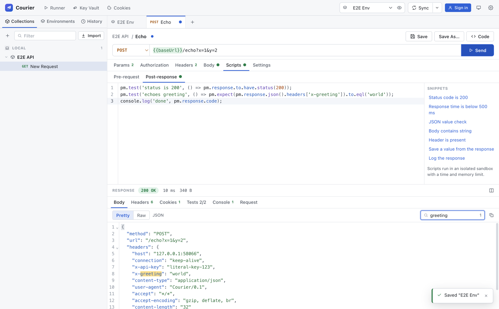
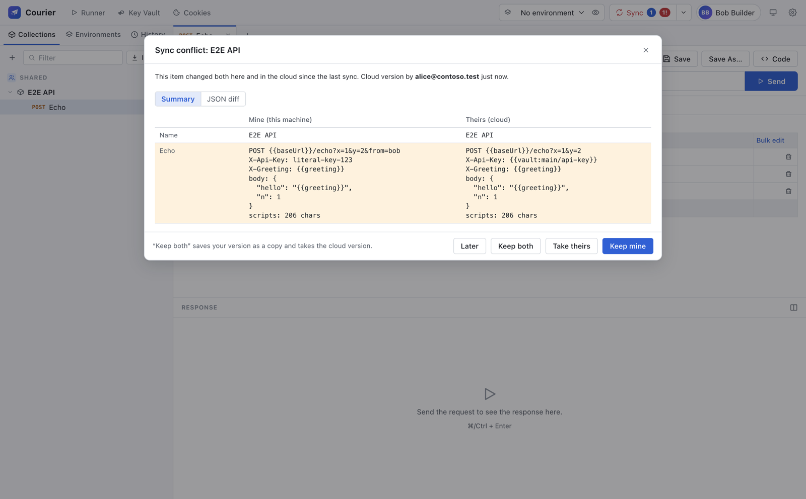
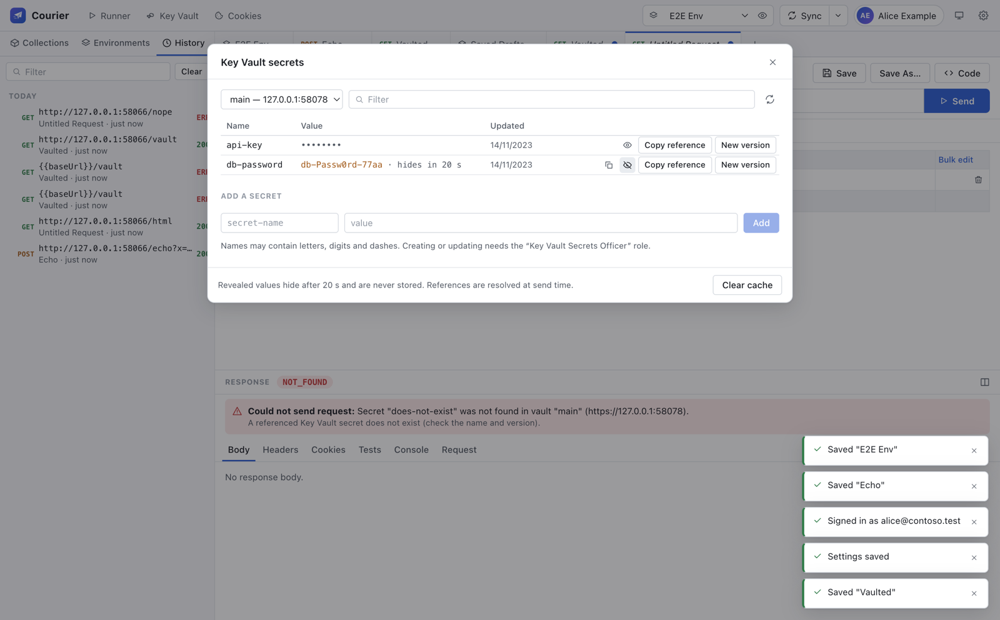

<p align="center"></p>

# Courier

Courier is a desktop API client (a Postman alternative) built with Electron and React. Your team shares
collections and environments through **your own Azure Storage account**, secrets come from **Azure Key
Vault**, and you sign in with your **Azure (Entra ID) identity**. There are no Courier servers,
storage account keys, SAS tokens or connection strings.

- Requests with params, headers, auth, every common body type, and pre-request and post-response
  scripts (`pm.*` subset, sandboxed in QuickJS)
- Collections, folders, environments, globals and history. Tabs keep unsaved drafts.
- Collection runner with iterations, delay, stop-on-failure and a CSV/JSON data file
- Import Postman v2.0/v2.1 collections and environments, OpenAPI 3 and cURL; export to Postman or Courier JSON
- Code snippets for cURL, JavaScript `fetch` and Python `requests`. Secrets in snippets are masked.
- Cookie jar, plus light and dark themes that follow the system setting

## Screenshots

Captured by the end-to-end test run; the accounts and endpoints shown are test fixtures.

| | |
| --- | --- |
|  Request, scripts and response |  Dark theme |
|  Sync conflict |  Key Vault browser |
|  Collection runner | |

For the feature-by-feature comparison with Postman, see the parity table in
[docs/RESEARCH.md](docs/RESEARCH.md#4-parity-table).

## Spaces

Every collection and environment lives in one space. Move it with right-click, then **Move to space**:

| Space | Where it is stored | Who can read it |
| --- | --- | --- |
| **Local** | This machine only (userData) | You |
| **Personal** | Blob prefix `users/<your object id>/` in the team container | Anyone with data access to the container. It is separated by prefix only, so it is **not** private. |
| **Shared** | Blob prefix `shared/` in the team container | Your team |

Cloud items are cached locally, so Courier works offline. Saving only marks an item as changed. To
upload your changes and download your team's changes, press **Sync**. Uploads use ETag
preconditions. When the cloud copy and your copy both changed, Courier shows a conflict dialog that
compares your version with the cloud version. You can then **Keep mine**, **Take theirs** or **Keep
both** (your version is saved as a copy).

Before an item goes to the **Shared** space, Courier scans it for literal credentials, such as an
`Authorization` or `X-Api-Key` header, a Basic/Bearer/API-key/OAuth secret, or a secret-looking
variable. It then asks you to cancel or proceed. The better fix is a Key Vault reference (see below).

### Blob layout

One container holds one JSON blob per collection (the whole tree) or environment. The JSON is
deterministic and pretty-printed:

```
<container>/
  shared/collections/<id>.json
  shared/environments/<id>.json
  users/<oid>/collections/<id>.json
  users/<oid>/environments/<id>.json
```

Each document records `updatedBy` (UPN or name) and `updatedAt`. Some data never leaves this machine:
current values, globals, history, cookies and settings. Variables of type **secret** are written to
cloud documents with an empty value. Their real value lives only in this machine's current values.

## Secrets: Azure Key Vault references

Configure one or more vaults under **Settings → Key Vault** as `alias` + `https://<name>.vault.azure.net`.
The first vault is the default. You can use a reference anywhere `{{variables}}` work: URL, params,
headers, body and auth fields.

```
{{vault:secret-name}}            default (first) vault
{{vault:alias/secret-name}}      a specific vault
{{vault:alias/secret-name@ver}}  a pinned version
```

A variable can also have the type **Key Vault**, with a reference such as `main/api-key` as its
value. A plain `{{apiKey}}` then resolves through Key Vault. Scripts can call
`pm.vault.get('name')`, but only in collections you allow (see below).

### Scripts and Key Vault: allowed per collection, on this machine

Collections sync through a shared container, so anyone with write access to it can change a
collection's scripts, and scripts run with the identity of whoever presses Send. By default, scripts
therefore cannot obtain Key Vault values. To let a collection's scripts read secrets, open the collection's
settings (**Overview**) and turn on **Allow this collection's scripts to read Key Vault secrets**.

- The permission is stored in this machine's userData, keyed by collection id. It is never part of the
  collection document, so it is never uploaded and a teammate cannot turn it on for you. It starts
  off for every collection in every space, including local collections and imported files.
- The permission is bound to a hash of all script text in the collection (collection, folder and
  request scripts). Your own saves keep it. If the scripts change any other way, for example through
  a sync or by taking "theirs" in a conflict, the permission turns off, and the setting says when and who
  last updated the collection.
- Only saved script text gets the permission. A request tab with unsaved script edits, a request
  reopened from history, or a "duplicate as draft" copy must be saved first. Saving counts as approval, so
  review the script in the tab before you save it into an allowed collection.
- When a script is blocked, `pm.vault.get` rejects, and `pm.sendRequest` rejects if its URL, headers
  or body contain a `{{vault:…}}` reference. The error code is `VAULT_SCRIPT_BLOCKED`, and the response
  pane and the runner offer **Open collection settings**. A blocked pre-request script stops the
  request from being sent. Some other things also change while scripts are blocked:
  - Variables whose value holds a `{{vault:…}}` reference, such as Key Vault-typed variables, read as
    `••••` in scripts (`pm.variables`, `pm.environment`, `replaceIn`, `toObject`). A blocked script that
    copies such a value into the request, for example `'Bearer ' + pm.environment.get('apiKey')`, sends a
    literal `••••` and gets no error. When scripts are allowed, they see the reference text and resolve it
    with `pm.vault.get`.
  - Test scripts see the response with Key Vault values masked.
  - A pre-request script cannot add `{{vault:…}}` references to the request, or change where a request
    that carries them is sent (its origin or OAuth token URL). In the runner, this also covers variables
    that an earlier request of the same run changed.
- `{{vault:…}}` references in the request itself (URL, params, headers, body and auth) always resolve.
  They are visible in the editor. However, a declarative reference in a shared request is sent to whatever URL
  that request targets, so review shared requests (and the variables their URL uses) before you send
  them.

Known limits: the hash covers script text only. An allowed script that takes its destination or the
secret name from a variable can still be steered by someone who edits that variable. A variable
value that a script persisted in one send is the baseline for later sends.

Courier fetches secrets in the main process at send time, using your identity. It keeps them in
memory for a short time (the TTL is configurable) and never writes them to disk. Wherever a secret
could show up outside the live request, Courier shows `••••` instead: history, the console, the
response view, the "Request" view and code snippets.

The **Key Vault** browser on the toolbar lists the secret names in each vault. It can reveal a value
on demand (the value hides again after 20 s), copy a `{{vault:…}}` reference, create a new version,
and clear the cache.

## Azure roles required

| Resource | Role | Needed for |
| --- | --- | --- |
| Storage container | **Storage Blob Data Contributor** | Syncing (upload, download, delete) |
| Storage container | **Storage Blob Data Reader** | Read-only use: download only. Use **Discard local changes** for accidental edits. |
| Key Vault | **Key Vault Secrets User** | Resolving `{{vault:…}}` references and revealing values |
| Key Vault | **Key Vault Secrets Officer** | Creating new secret versions from the Key Vault browser |

Courier reports a missing role by name, both in the UI and in the error message, whenever Azure returns
a 403.

## Sign-in modes

You choose the mode under **Settings → Account**. Tokens stay in the main process. The renderer only
sees display claims: name, UPN, object id and tenant.

- **Automatic**: tries managed identity first, then the Azure CLI.
- **Azure CLI**: reuses your `az login` session. You can set a tenant id.
- **Browser sign-in**: interactive sign-in in the system browser. You can set the tenant id and the
  public client id. The default client id is the Azure CLI's.
- **Managed identity**: system-assigned, or user-assigned by client id. This mode **only works when
  Courier runs on Azure-hosted compute**, such as an Azure VM, an Azure Virtual Desktop session host
  or an Arc-enabled server. On other machines it reports that it is unavailable.

**Request auth → Azure identity (Entra ID token)** sends `Authorization: Bearer <token>`. The token is
issued to the signed-in identity for a scope you choose, for example
`https://graph.microsoft.com/.default`.

## Setup and development

Requirements: Node 22 and macOS, Windows or Linux. On an Apple-silicon Mac with a Rosetta shell, prefix the
commands with `arch -arm64`.

```sh
npm install
npm run dev          # electron-vite dev server with hot reload
npm run typecheck    # tsc --noEmit
npm test             # vitest: engine unit/integration tests (Azurite + mock Key Vault, no real Azure)
npm run build        # production build into out/
npm run e2e          # build, then drive the real UI end to end (see below)
npm run smoke:engine # build, then round-trip window.courier calls
npm run dist         # package with electron-builder
```

Shortcuts (⌘ on macOS, Ctrl elsewhere): **⌘T** new request tab, **⌘W** close tab, **⌘S** save,
**⌘⇧S** save as, **⌘↩** send, **⌘,** settings, **F2** rename in the tree. A middle click closes a
tab.

### End-to-end test

`e2e/drive.mjs` uses `playwright-core`'s `_electron` driver. It starts the following, all locally:

- an HTTP echo server
- Azurite blob storage over HTTPS with `--oauth basic` and a throw-away self-signed certificate
- a mock Key Vault speaking the secrets REST API, including the 401 challenge

It then launches the built app with a temporary `COURIER_USER_DATA`, a fake identity
(`COURIER_FAKE_IDENTITY`) and `NODE_EXTRA_CA_CERTS`. It drives the real UI by clicking and typing, in
this order:

1. Collection, request, environment variables, headers, JSON body, test script, Send, assertions
2. A Key Vault-backed header and a `pm.vault.get` script. The test first checks that the script is blocked,
   both as an unsaved draft and once the request is saved to a collection. It then turns on the collection's
   Key Vault permission through the UI, sends again, and checks that the secret is masked in the UI and
   absent from every file under userData.
3. Storage settings, sign-in, moving to Shared (secret warning) and sync. A second app instance with
   another identity syncs the collection. Both instances edit it, which produces the conflict
   dialog, and the conflict is resolved.
4. A runner pass with 2 iterations
5. Postman import, send, export, and a cURL paste
6. Light and dark screenshots

Screenshots are written to `e2e/screenshots/`, and the script exits non-zero on any failed check.
Nothing touches a real Azure resource.

Test-only hooks honoured by the main process: `COURIER_USER_DATA`, `COURIER_FAKE_IDENTITY` (JSON
`{name,upn,oid,tid}`, which mints unsigned JWTs), `COURIER_KV_INSECURE_CHALLENGE=1` (relaxes the Key
Vault challenge-resource check for the mock vault on 127.0.0.1) and `NODE_EXTRA_CA_CERTS`.

## Layout

```
src/shared/    types, the window.courier API contract (api.ts), variables, import/export, codegen
src/main/      Electron main: IPC, HTTP engine, script sandbox, runner, Azure identity, blob sync, Key Vault
src/preload/   the typed window.courier bridge (contextIsolation, sandboxed renderer)
src/renderer/  React UI (zustand store, CodeMirror editors, own CSS with light/dark variables)
tests/         vitest
e2e/           drive.mjs (UI end to end), infra.mjs (Azurite / mock vault / echo), engine-smoke.mjs
```

## Security notes

- The renderer is sandboxed (`contextIsolation`, no Node integration) and runs under a strict CSP:
  no remote scripts or fonts, and no inline scripts.
- HTML response previews render in a `sandbox=""` iframe, so their scripts never run.
- Request body files can only come from the native file picker.
